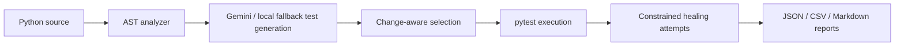

<div align="center">

# Agentic AI Test Generator — Research Prototype
**Gemini-backed generation · Predictive selection · Constrained healing · CI comparison**


[Source](https://github.com/ChiththajaGalabodage/AI_agents_updated_project) · [Update notes](UPDATE_SUMMARY.md) · [Comparison artifacts](reports/)

</div>

## About

This repository captures an **earlier prototype** developed while investigating the application of large language models to continuous testing. It contains modular source analysis, pytest test generation, change-based selection, limited self-healing, structured reporting, and agentic-versus-traditional comparisons.

It is **not the same implementation or experimental snapshot** as the revised thesis's final FastAPI LLM-CTF. Refer to [`Fast-API-Project-main`](https://github.com/ChiththajaGalabodage/Fast-API-Project-main) for that case-study code.

## Implemented workflow



| Module | Purpose |
|---|---|
| `src/analyzer.py` | Extract source structure |
| `src/generator.py` | Generate tests with Gemini or deterministic fallback |
| `src/test_select_agent.py` | Identify impacted tests |
| `src/healer.py` | Handle limited failures in generated tests |
| `src/runner.py` | Execute selected tests |
| `src/reporter.py` | Write structured results |
| `scripts/compare_methods.py` | Run traditional-versus-agentic experiments |
| `.github/workflows/pipeline.yml` | Execute CI workflow and upload artifacts |

## Installation

```bash
git clone https://github.com/ChiththajaGalabodage/AI_agents_updated_project.git
cd AI_agents_updated_project
python -m venv .venv
# Windows: .venv\Scripts\Activate.ps1
# macOS / Linux: source .venv/bin/activate
pip install -r requirements.txt
```

For live Gemini calls, set `GEMINI_API_KEY` locally or in the Actions repository secrets. Without the key, behavior may use a deterministic fallback: **never label fallback output as live LLM results**.

## Run

```bash
# Main agentic pipeline
python main.py --source target_code.py --max-heal-attempts 2 --predictive-test-selection

# Repeat the agentic versus traditional comparison
python scripts/compare_methods.py --source target_code.py --runs 3

# Validate the generated suite
python scripts/validate_generated_tests.py
```

Optional watch mode is implemented in the original project: `python main.py --source target_code.py --watch`.

## Result artifacts and appropriate claims

Check `reports/comparison_report.json`, `reports/comparison_report.csv`, `reports/comparison_report.md` and the project-specific `reports/` directory for per-run outputs. [`UPDATE_SUMMARY.md`](UPDATE_SUMMARY.md) documents a particular earlier experiment, including a framework regression check and changes to defect-preservation behavior.

**Important measurement caveat:** Some older comparison reports use a *failed-tests proxy* called `defects_detected`. That is **not** a validated count of unique product defects. Treat those counts as run-level failure indicators unless independently mapped to distinct confirmed faults. Likewise, a pass rate or lower test count alone does not establish superiority.

## Scope and limitations

- Experimental modules and reports reflect an evolving research prototype.
- An offline/deterministic fallback is not evidence of LLM accuracy.
- Self-healing is limited and must not hide valid failures in the target product.
- The revised thesis's **78 vs 16** result, **24 controlled replays**, **12 mutants** and **109-test final gate** belong to a different recorded study; do not attribute those measurements to this repo.

**Research context:** *Enhancing Continuous Testing in DevOps and CI/CD Pipelines Using Large Language Models*.

**Author:** [Chiththaja Galabodage](https://github.com/ChiththajaGalabodage)
